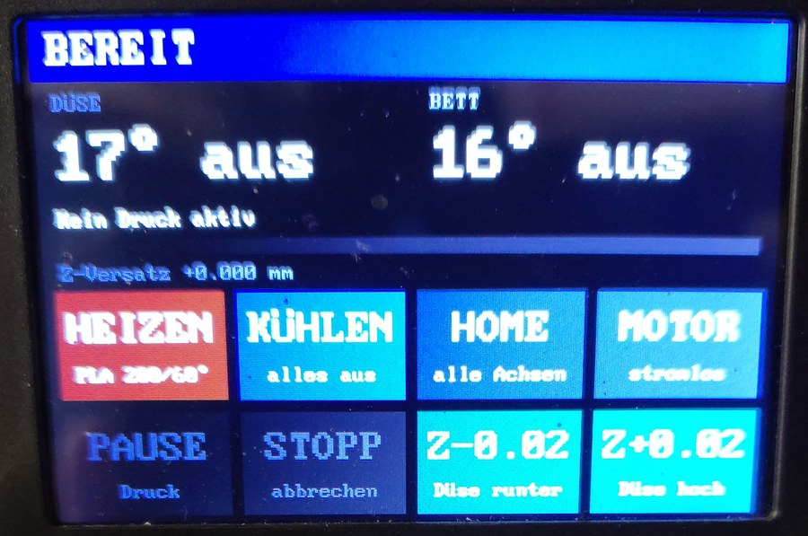
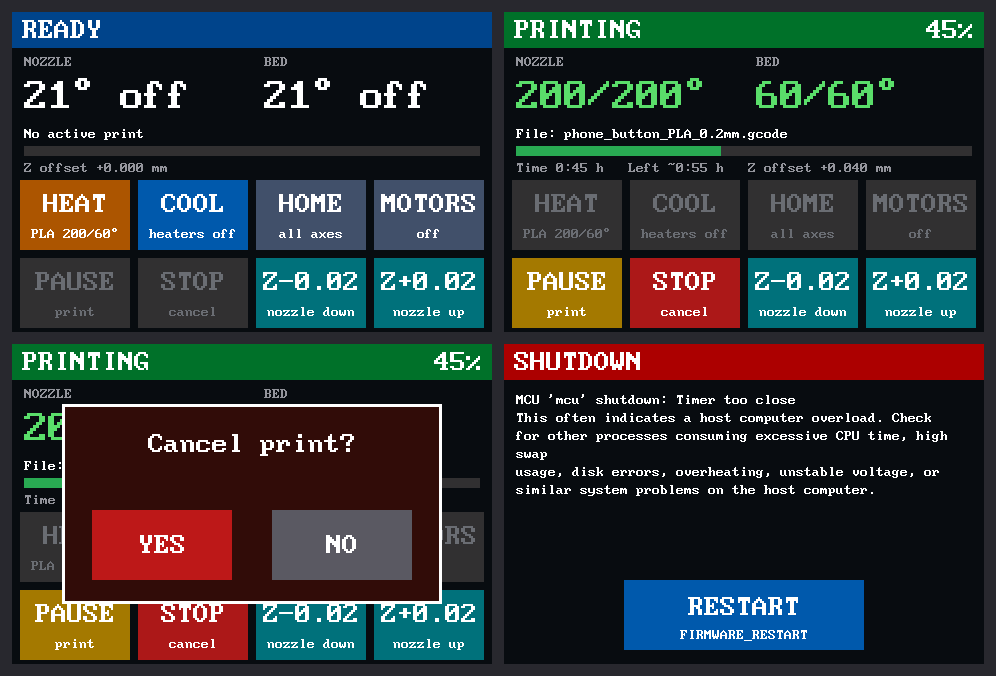
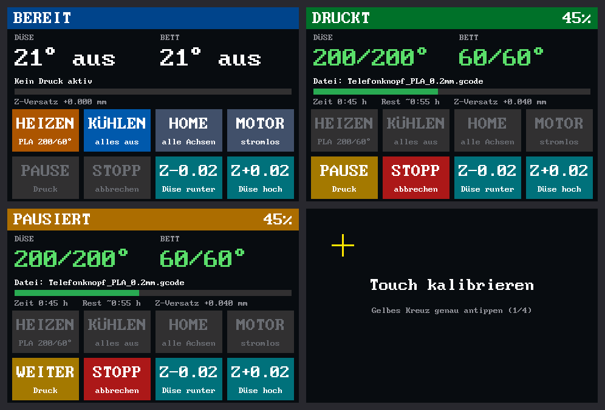
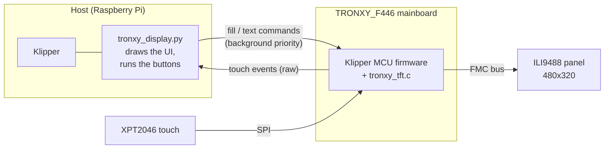

# Klipper with support for the Tronxy stock touch screen

This is a fork of [Klipper](https://github.com/Klipper3d/klipper) that
brings the original 3.5" touch screen of Tronxy printers with the
**TRONXY_F446 mainboard** (STM32F446, for example the **X5SA Pro**)
back to life. With upstream Klipper the screen stays frozen on the
Tronxy boot logo, because it sits on the FMC memory bus of the
micro-controller and none of Klipper's display drivers can talk to it.

Everything else is unchanged upstream Klipper (currently **v0.14.0**).
All changes live in branch `tronxy-x5sa-tft`, the full guide is in
[docs/Tronxy_TFT.md](docs/Tronxy_TFT.md).



*Running on a Tronxy X5SA Pro with the German user interface.*

## What the screen shows

* Printer state in a colored bar (ready, printing, paused, complete,
  cancelled, error) and the progress in percent
* Nozzle and bed temperature, current and target, colored while heating
* File name or `M117` message, progress bar, print time, estimated
  time left and the current Z offset
* Eight touch buttons:

  | Button | Action |
  |---|---|
  | Heat | preheat for PLA (temperatures configurable) |
  | Cool | all heaters off |
  | Home | `G28` |
  | Motors | motors off (`M84`) |
  | Pause / Resume | `PAUSE` / `RESUME` |
  | Stop | `CANCEL_PRINT`, after a yes/no confirmation |
  | Z- / Z+ | Z offset -/+ 0.02 mm (babystepping during the first layer) |

* Buttons that make no sense right now are greyed out, for example
  home and cool down while printing
* Errors from a button action are shown on the screen
* After a shutdown: the reason and a big `FIRMWARE_RESTART` button
* Touch calibration with `TRONXY_TOUCH_CALIBRATE`
* English or German user interface (`language: en` / `de`)



*English user interface: ready, printing, cancel confirmation, shutdown
(rendered from the real drawing commands).*



*German user interface: ready, printing, paused, touch calibration.*

## How it works



* The **MCU part** (`src/stm32/tronxy_tft.c`) initializes the panel,
  shows "Waiting for Klipper..." until the host connects, provides
  simple fill and text commands (built-in 8x16 font) and reports each
  touch once with raw values.
* The **host part** (`klippy/extras/tronxy_display.py`) draws the
  screen, redraws only what changed and runs the G-code of the buttons.
  All display traffic uses background priority on its own command
  queue, so it never delays motion data. A full redraw is about 1 KB,
  a temperature update about 50 bytes.

## Quick start

You need SSH access to the Pi and an SD card for the printer.

1. **Host module.** Keep your normal Klipper installation and add the
   module next to your config:
   ```
   cd ~/printer_data/config
   wget https://raw.githubusercontent.com/urglas19-lab/klipper/tronxy-x5sa-tft/klippy/extras/tronxy_display.py
   ln -sf ~/printer_data/config/tronxy_display.py ~/klipper/klippy/extras/tronxy_display.py
   ```
2. **MCU firmware.** If your host runs exactly Klipper v0.14.0, take
   `fmw_tronxy.bin` from the
   [latest release](https://github.com/urglas19-lab/klipper/releases/latest).
   Otherwise build it yourself from this branch, see
   [building the firmware](docs/Tronxy_TFT.md#building-and-flashing-the-mcu-firmware).
   Put the file into a folder `update` on a FAT32 SD card, insert the
   card, switch the printer off and on, wait, then remove the card.
3. **Config.** Add to `printer.cfg`:
   ```
   [tronxy_display]
   language: en
   #preheat_extruder_temp: 200
   #preheat_bed_temp: 60
   ```
4. **Restart the Klipper service**, for example with
   `sudo systemctl restart klipper` or from the power menu of Mainsail
   or Fluidd. A plain `RESTART` is not enough the first time, because
   Klipper keeps already loaded Python modules.
5. Optional: run `TRONXY_TOUCH_CALIBRATE`, tap the four crosses and
   store the result with `SAVE_CONFIG`.

If the firmware has no display support (for example after flashing
plain Klipper), the module only logs a warning and Klipper starts
normally.

## After updating Klipper

Klipper updates can change the protocol between host and MCU (v0.14.0
did). After an update, build and flash the MCU firmware again from
the matching version of this branch. Check the
[releases](https://github.com/urglas19-lab/klipper/releases) for a
pre-built file first.

Klipper v0.14 lists the linked module as an untracked file and may
show the host version with a `-dirty` suffix. That is cosmetic.

## Status

* Tested on one Tronxy X5SA Pro with the TRONXY_F446 board.
* Other Tronxy printers with the same board and screen should work,
  but have not been tested. Reports are welcome.
* The panel is a TN type: viewed from above, mid-tone colors look
  lighter and white text on colored buttons is harder to read.
* Only the status page exists: no menus, no file selection.

## Credits

* Panel access is based on `hbtft.c` from the
  [Hellbot Magna 2 300 Klipper fork](https://github.com/adrianeb2015/klipper.on.hellbot.magna.2.300)
  by adrianeb2015 (GPLv3).
* Pins and FMC timing were taken from Marlin (`pins_TRONXY_F446.h`).
* Font: VGA 8x14 font shipped with Klipper (Joseph Gil, public domain).

License: GPLv3, like Klipper.

---

# Original Klipper README

Welcome to the Klipper project!

[](https://www.klipper3d.org/)

https://www.klipper3d.org/

The Klipper firmware controls 3d-Printers. It combines the power of a
general purpose computer with one or more micro-controllers. See the
[features document](https://www.klipper3d.org/Features.html) for more
information on why you should use the Klipper software.

Start by [installing Klipper software](https://www.klipper3d.org/Installation.html).

Klipper software is Free Software. See the [license](COPYING) or read
the [documentation](https://www.klipper3d.org/Overview.html). We
depend on the generous support from our
[sponsors](https://www.klipper3d.org/Sponsors.html).
