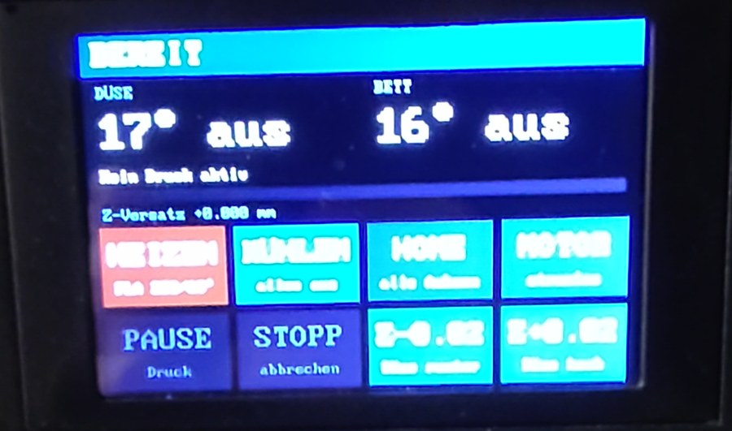
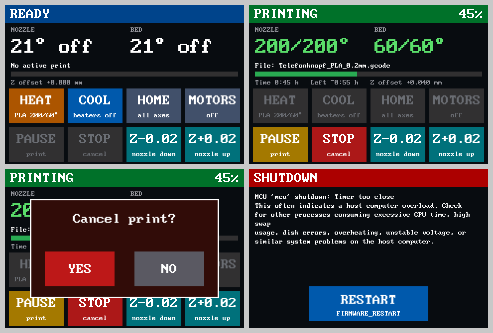

# Tronxy stock touch screen

This fork adds support for the stock 3.5" touch screen of Tronxy
printers with the TRONXY_F446 mainboard (STM32F446, for example the
X5SA Pro). Upstream Klipper cannot drive this screen: the panel is
attached to the FMC memory bus of the micro-controller, not to SPI or
I2C, so none of the existing display drivers fit.



*Running on a Tronxy X5SA Pro (German UI). The panel is a TN type;
seen from above, mid-tone colors look much lighter than intended, see
[known limitations](#known-limitations).*



## Features

* Status page: printer state, progress, nozzle and bed temperature
  (current/target), file name or `M117` message, print time, estimated
  time left and the current Z offset.
* Eight touch buttons: preheat (PLA), cool down, home, motors off,
  pause/resume, cancel print (with a confirmation dialog) and Z offset
  -/+ 0.02 mm for babystepping during the first layer.
* Buttons that make no sense in the current state are greyed out (for
  example home and cool down while printing).
* Errors raised by a button action are shown on the screen.
* After a shutdown the screen shows the reason and offers a
  `FIRMWARE_RESTART` button.
* Touch calibration with `TRONXY_TOUCH_CALIBRATE`.
* English or German user interface.

## How it works

The work is split between the micro-controller and the host:

* `src/stm32/tronxy_tft.c` (MCU): initializes the ILI9488 panel on FMC
  bank 4 on its own and shows a boot screen until Klipper connects. It
  provides a few simple commands: `tronxy_tft_fill` (filled rectangle),
  `tronxy_tft_text` (text in a built-in 8x16 code page 437 font, scale
  1-4), `tronxy_tft_backlight` and `tronxy_tft_query`. The XPT2046
  touch controller is polled every 25 ms; each touch is reported once
  as `tronxy_tft_touch` with raw values. Panel initialization runs as
  a non-blocking state machine, so the MCU watchdog is never at risk.
* `klippy/extras/tronxy_display.py` (host): draws the user interface,
  maps raw touch values to screen coordinates and runs the G-code of
  the buttons. Only fields that changed are redrawn. All display
  commands go through their own command queue with background
  priority, so they never delay motion data. A full redraw is about
  1 KB, a temperature update about 50 bytes.

## Hardware

Tested on a Tronxy X5SA Pro with the TRONXY_F446 board
(STM32F446ZET6, 64 KiB Tronxy bootloader, 8 MHz crystal, host
connection through a CH340 on USART1). Other Tronxy printers with the
same board and screen should work, but have not been tested.

| Function | Pins |
|---|---|
| Panel data D0-D15 (FMC) | PD14, PD15, PD0, PD1, PE7-PE15, PD8-PD10 |
| Panel NOE / NWE / NE4 / RS (A12) | PD4 / PD5 / PG12 / PG2 |
| Panel reset / backlight | PB12 / PG8 |
| Touch CS / SCK / MISO / MOSI | PD11 / PB13 / PB14 / PB15 |

These pins are claimed by the display code. Do not use them for
anything else in the printer config.

## Building and flashing the MCU firmware

Check out this branch and run `make menuconfig`:

```
[*] Enable extra low-level configuration options
    Micro-controller Architecture (STMicroelectronics STM32)
    Processor model (STM32F446)
    Bootloader offset (64KiB bootloader)
    Clock Reference (8 MHz crystal)
    Communication interface (Serial (on USART1 PA10/PA9))
(250000) Baud rate for serial port
[*] Tronxy stock TFT (ILI9488 on FMC + XPT2046 touch)
[ ]   Tronxy stock TFT: German boot screen text
```

Then run `make`. To flash, copy `out/klipper.bin` to a FAT32 SD card
as `update/fmw_tronxy.bin`, insert the card, switch the printer off and
on again and wait until the bootloader has finished, then remove the
card. The bootloader itself is not touched, so going back to plain
Klipper or the stock firmware works the same way.

## Host side

The host module has to match the firmware. Either:

* run this branch on the host as well, or
* keep upstream Klipper on the host at the same version this branch is
  based on and link the module into it:
  ```
  ln -sf /path/to/tronxy_display.py ~/klipper/klippy/extras/tronxy_display.py
  ```

As usual with Klipper, build the MCU firmware from the same Klipper
version that runs on the host.

If the MCU firmware does not contain the display commands (for example
after flashing plain Klipper), the module only logs a warning and stays
inactive, Klipper starts normally.

## Configuration

```
[tronxy_display]
#mcu: mcu
#   The micro-controller the screen is connected to.
#language: en
#   User interface language: en or de.
#preheat_extruder_temp: 200
#preheat_bed_temp: 60
#   Targets set by the preheat button.
#z_step: 0.02
#   Z offset change per tap of the Z buttons (mm).
#touch_x_left: 3756
#touch_x_right: 200
#touch_y_top: 134
#touch_y_bottom: 3878
#   Raw touch values (12 bit) at the screen edges. Run
#   TRONXY_TOUCH_CALIBRATE and SAVE_CONFIG instead of editing them.
```

The buttons run these commands:

| Button | G-code |
|---|---|
| Preheat | `M104 S<preheat_extruder_temp>`, `M140 S<preheat_bed_temp>` |
| Cool down | `TURN_OFF_HEATERS` |
| Home | `G28` |
| Motors off | `M84` |
| Pause / Resume | `PAUSE` / `RESUME` |
| Cancel | `CANCEL_PRINT` (after confirmation) |
| Z- / Z+ | `SET_GCODE_OFFSET Z_ADJUST=-/+<z_step> MOVE=1` (`MOVE=1` only when homed) |

`PAUSE`, `RESUME` and `CANCEL_PRINT` must exist, for example from the
macros shipped with Mainsail or Fluidd.

## G-code commands

* `TRONXY_TOUCH_CALIBRATE`: shows four crosses one after the other.
  Tap each one; the new values are applied immediately and stored with
  `SAVE_CONFIG`. The crosses sit well inside the screen because the
  bezel makes the very edges hard to hit.
* `TRONXY_DISPLAY_REDRAW`: redraws the whole screen.

## Known limitations

* Tested on one printer only.
* The panel is a TN type. Seen from above (the usual angle on the
  X5SA), mid-tone colors look much lighter than intended and white
  text on colored buttons becomes hard to read. Saturated colors and
  dark backgrounds are not affected.
* Only the status page exists: no menus, no file selection.
* While the host is not connected the boot screen ("Waiting for
  Klipper...") stays. If the host stops, the last screen stays.

## Credits

* Panel access is based on `hbtft.c` from the Hellbot Magna 2 300
  Klipper fork by adrianeb2015
  (github.com/adrianeb2015/klipper.on.hellbot.magna.2.300, GPLv3).
* Pins and FMC timing were taken from Marlin (`pins_TRONXY_F446.h`,
  `tft_fsmc.cpp`, GPLv3).
* Font: VGA 8x14 font shipped with Klipper (Joseph Gil, public
  domain).
